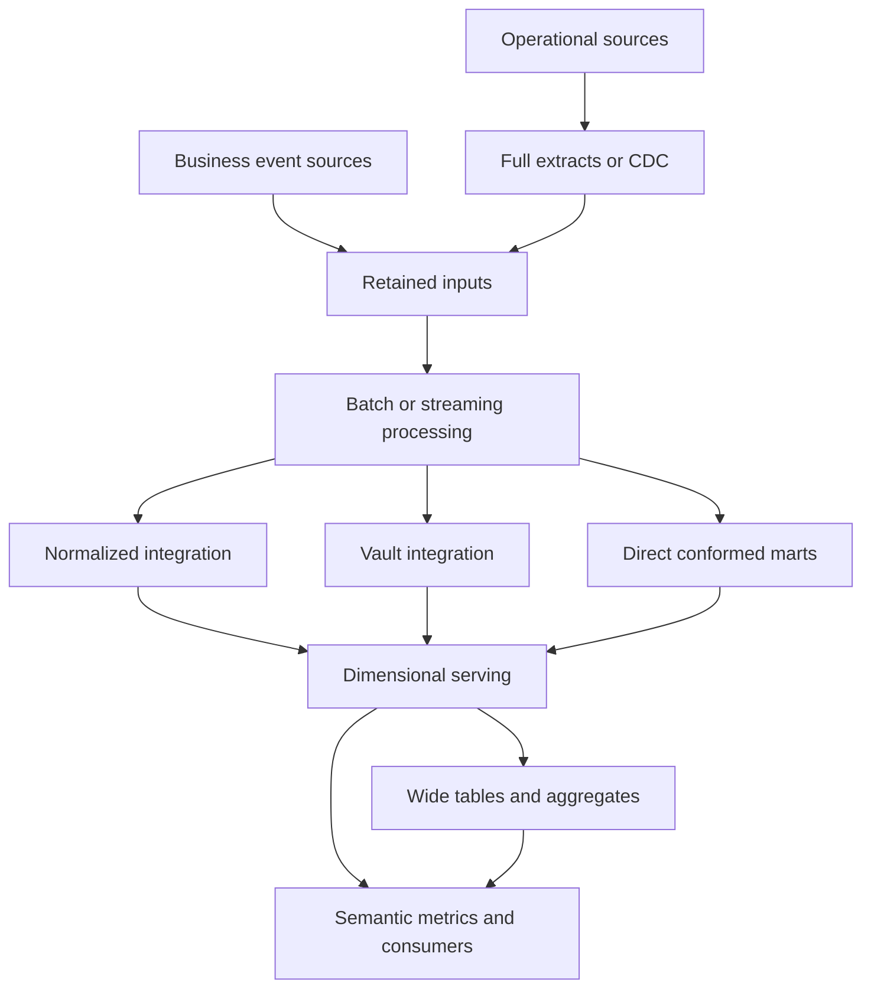

# Data Modeling & Analytical Architecture Patterns

**Architecture and learning plan — approved v0.0.1 baseline, 15 October 2026**

Repository: `data-modeling-patterns`  
Primary case study: a fictional Canadian credit-card issuer, CAD first  
Status: Phase 1 architecture approved by the learner. Module 01A domain decisions and dictionary were explicitly approved on 15 October 2026; the current repository checkpoint remains documentation-only.

## Approval record and how to read this baseline

This is the complete architecture plan supplied and approved in the learning session, included in the repository for self-contained handoff. All original numbered planning sections, module scopes, dependencies and version milestones below are preserved. Original future-tense, “proposed” and stop-for-approval wording describes the planning stage; the architecture approval gate has since been satisfied.

The learner subsequently approved these bounded Module 01A refinements: universal exactly-one ACTIVE PRIMARY for OPEN accounts and atomic initial creation; one retained participation triple without role transfers and with mutually exclusive active roles per customer/account; limited issuance/status behavior that preserves legitimate historical postings; an explicit refund-validation boundary; duplicate rejection and posting immutability with administrative reset separate; and the dictionary's requiredness, statuses, nonnegative credit limit and timestamp/reference semantics.

The current authoritative detail for those refinements is in [business-rules.md](../domain/banking/business-rules.md), [conceptual-model.md](../domain/banking/conceptual-model.md), [data-dictionary.md](../domain/banking/data-dictionary.md) and [DECISIONS.md](../DECISIONS.md). They refine Module 01A only. No later-module scope or milestone is changed. See [PROGRESS.md](../PROGRESS.md) for what has actually been taught, approved and implemented.

Approval of business policy does not establish a PostgreSQL implementation or runtime verification. Continue the agreed teach → exercise → review → implement → verify workflow one concept at a time.

## 1. Critical review and design position

The charter is a strong foundation for a senior-level learning repository, but its 17 modules span several architectural layers and would become unmanageable if every topic received equal implementation depth. Preserve the full map; concentrate engineering effort on correctness, history, replay, reconciliation, and explainable decisions.

The central recommendation is **one evolving banking case study, several deliberately comparable representations, and a shared set of business assertions**. A customer or posting must retain its business meaning when represented in 3NF, a star, a Vault, an OBT, and Medallion layers.

### Changes to the charter

1. **Replace the implied migration ladder with a dependency graph.** An OLTP model can already be in 3NF. Kimball, Data Vault, Medallion, Kappa and Mesh are not successive maturity levels. A team can use several simultaneously, or reasonably choose not to use some.
2. **Separate conceptual, logical and physical design.** Business identity and cardinality come first; tables and history strategies follow; indexes, partitioning and files come after access patterns and measurements.
3. **Teach event identity and time before incremental warehouse loading.** Late data, SCD2, corrections and CDC require distinctions between business occurrence, source recording, arrival and processing time.
4. **Split Module 2 into several checkpoints.** Grain, facts, dimensions, history, bridges and late data are too substantial for one implementation session.
5. **Use normalization arguments, not just more tables.** Record functional dependencies and all candidate keys. A surrogate primary key does not remove dependencies between business attributes. Show lossless decomposition and discuss dependency preservation; a surrogate-key-only example cannot adequately teach partial dependency.
6. **Separate authorization, financial posting and dispute lifecycles.** A declined or expired authorization may never post; one authorization can lead to partial postings; a refund is a separate financial event; a dispute can reopen. These are not one linear status column.
7. **Distinguish a small model demonstration from an enterprise implementation.** The repository can demonstrate Vault structures, domain contracts or replay. It cannot establish enterprise organizational adoption, regulatory compliance or distributed guarantees merely through diagrams and local tests.
8. **Avoid two competing copies of every file.** Module SQL should have one authoritative location. Root notes should index module material instead of repeating it.
9. **Do not call Lambda obsolete, Kappa universally simpler, or OBT universally faster.** Their suitability depends on replay economics, source retention, update patterns, queries and operational requirements.
10. **Make the project releasable early.** v0.1.0 must run a narrow end-to-end example. v1.0.0 means the agreed teaching scope is complete, not that the system is production banking software.

This is a separate knowledge repository. Its patterns may later inform larger portfolio projects, but this plan does not change or replace any other repository.

## 2. Final taxonomy

Classification is multi-label: a pattern may address more than one layer. The primary label prevents false comparisons.

| Layer / design question | Patterns | What this repository must distinguish |
|---|---|---|
| Workload: what is the system doing? | OLTP, OLAP | Access and concurrency characteristics, not mandatory schema shapes |
| Logical modeling: what does a record mean? | 3NF/BCNF, dimensional models, star/snowflake, OBT, Anchor | Identity, dependencies, grain, relationships and measures |
| Integration and history modeling | Data Vault structures, temporal/bitemporal models, SCD | Source provenance, business history, corrections and time-aware joins; Data Vault 2.0 has a broader methodology than its table patterns |
| Enterprise warehouse architecture | Kimball bus, Inmon-style EDW, Hub-and-Spoke | Integration strategy, marts and delivery structure; Kimball includes enterprise architecture beyond individual stars |
| Storage/platform architecture | Warehouse, lake, lakehouse | Storage, transaction, compute, catalog and serving capabilities; product boundaries overlap |
| Refinement/layering | Medallion | Increasing quality and usability; it does not prescribe one logical model |
| Processing | Batch, micro-batch, streaming, Lambda, Kappa | Computation over time, state, latency, correction and replay |
| Integration/movement | Full extracts, incremental extraction, CDC, event-driven integration, outbox | How change moves between systems; CDC row changes do not automatically express business intent |
| Application state | Event sourcing; CQRS awareness | Event sourcing defines authoritative state history; CQRS separates read/write models; neither requires the other |
| Ownership/governance | Data Mesh, Data Fabric | Mesh emphasizes domain ownership, products, platform and federated governance; Fabric emphasizes metadata-assisted integration and governance |
| Cross-cutting capabilities | Contracts, semantic metrics, quality, lineage, access, orchestration, observability | Required capabilities across architectures, not a final optional layer |

Useful comparisons must specify the same decision axis. Compare 3NF and Vault for an integration model; compare a star and OBT for a serving workload. Compare Mesh and centralized ownership for responsibility boundaries. Do not score “Data Vault versus Lakehouse” as though choosing one excludes the other.

The major Module 17 matrix will contain the charter's 16 named patterns. Use separate tables for purpose/layer, semantics/history, and operational/governance consequences rather than one unreadable 16-column spreadsheet. Unsupported or non-applicable comparisons must say “not prescribed by this pattern.”

## 3. Proposed repository architecture

Keep the charter's stable topic IDs under `modules/`; use a roadmap to specify study order. Module numbers are identifiers, not dependency order. Create directories only when populated with meaningful content.

| Proposed path | Responsibility |
|---|---|
| `README.md` | Portfolio landing page: purpose, landscape, case study, technologies, quickstart, learning route, implemented patterns, comparison framework, interview value, status and future work |
| `docs/roadmap.md` | Prerequisites, checkpoints, release gates and links |
| `docs/architecture-landscape.md` | Taxonomy and composition diagrams |
| `docs/decision-framework.md` | Decision criteria, scored scenarios and sensitivity to assumptions |
| `docs/glossary.md`, `docs/sources.md` | Defined terminology and primary sources with access dates |
| `docs/environment.md`, `docs/verification.md` | Tested versions/platforms and commands; evidence and limitations |
| `docs/adr/` | Individual architecture decision records; superseded decisions preserved |
| `domain/banking/` | Business rules, conceptual model, dictionary, lifecycle rules, metric definitions and identity contracts |
| `domain/banking/contracts/` | Versioned source/event/product contracts, including compatible and breaking changes |
| `modules/01-relational-modeling/` through `modules/17-comparisons/` | The 17 charter topics, created incrementally |
| `src/modeling_patterns/` | Small shared Python package for deterministic fixtures, database execution and replay support |
| `fixtures/banking/` | Small committed source datasets, edge cases and reviewed expected results |
| `fixtures/ecommerce/`, `fixtures/subscriptions/` | Two later transfer exercises, not duplicate full platforms |
| `infra/` | Compose, database roles/bootstrap and optional lab profiles |
| `scripts/` | Thin entry points for setup, run, verification and release packaging |
| `tests/integration/` | Cross-module semantic equivalence, reconciliation and clean-run checks |
| `benchmarks/` | Query workloads, run protocol and measured results with environment metadata |
| `artifacts/` | Generated datasets, logs and reports; ignored by Git except selected compact evidence elsewhere |
| `.github/workflows/` | CI added alongside runnable labs |
| `pyproject.toml`, `uv.lock` | Project metadata and pinned dependency resolution |
| `PROGRESS.md`, `DECISIONS.md`, `LEARNING_NOTES.md`, `INTERVIEW_NOTES.md`, `CHANGELOG.md` | Status, decision index, reflective notes, interview index and releases |

Each runnable module contains `README.md`, `model.md`, ordered `sql/`, relevant `tests/`, `expected/`, `exercises.md` and `interview.md`. Add `diagrams/`, `python/` or a local `dbt/` project only when used. Module README combines tradeoffs, operational notes and failure behavior to avoid 27 repetitive files.

Root `DECISIONS.md` indexes ADRs; root `INTERVIEW_NOTES.md` indexes module interview answers. Shared domain rules are authoritative in `domain/banking/`. SQL appears once, owned by the module introducing it. Later modules consume stable outputs or run prerequisites through the common runner.

Every lab has a distinct schema or isolated database namespace. Intentionally broken tables belong under a clearly labeled `anti_patterns` schema. Destructive reset commands operate only on project-owned lab resources. Migrations and prerequisite execution are explicit, not dependent on hidden notebook state.

## 4. Dependency-aware learning sequence

| Stage | Study order | Why this order matters |
|---|---|---|
| A: meaning and correctness | Domain contract → M01 operational workloads → M01 normalization → small M06/M09 identity/time primer | Establish what a row, change, event and timestamp mean before copying data |
| B: analytical semantics | M02 grain and bus matrix → dimensions/transaction facts → snapshots/lifecycles → SCD → late data/bridges | Each later exercise depends on an explicit grain and temporal policy |
| C: integration choices | M03 Kimball/Inmon → M13 topology primer → M04 Vault → M05 OBT → remainder of M06 | Compare alternative representations against the same business answers |
| D: platform and quality | M07 warehouse/lake/lakehouse → M08 Medallion | Separate table semantics from physical storage and refinement boundaries |
| E: movement and time | Full M09 batch/events → M12 CDC → M10 Lambda → M11 Kappa | Learn source-change semantics before composing replay and serving paths |
| F: enterprise responsibility | Full M13 → M14 Mesh → M15 Fabric → M16 platform synthesis → M17 capstone | Ownership and governance decisions are more meaningful after their technical consequences are visible |

Module 16 receives a short orientation at the start, then a substantive synthesis near the end. Module 17's matrix grows throughout; it is reviewed comprehensively at the capstone. Previously completed modules are not duplicated when revisited.

## 5. Local technical environment

### Required from the first implementation

| Tool | Proposed role | Boundary |
|---|---|---|
| PostgreSQL 18 | Relational source and SQL modeling labs | Use a supported stable release; select and pin an exact current patch image and digest during implementation |
| Docker Compose | Reproducible database service | One service initially, health check, named volume and localhost-only port binding |
| Python 3.12 with uv | Data generation, execution and test automation | Small package, pinned dependencies; verify available compatible patch at setup |
| SQL and psql | DDL, transformations, exploration and verification | Business rules remain visible in SQL; Python coordinates rather than obscures them |
| psycopg and pytest | Database integration checks and failure/replay tests | Test real invariants and recovery, not trivial file existence |
| Ruff and SQLFluff | Python/SQL consistency | Configure only for actual languages/dialects introduced |
| Git and Mermaid | Reproducibility, decisions and diagrams | Renderable diagrams tied to current model |

Expected baseline is a single PostgreSQL container plus host Python, suitable for an ordinary development laptop. Resource limits and a sub-five-minute smoke test are design targets, not measured promises. Record actual run times and hardware after implementation. Check ARM64 image and package compatibility before locking the environment. Local passwords are development values in an ignored environment file; public examples use placeholders.

### Introduce tools only at their teaching point

- **dbt Core:** in advanced Module 2, once ordinary SQL loads are understood. Use it for dependency graphs, tests and documentation. Keep source writes and CDC ingestion outside dbt. Do not assume a generic snapshot strategy demonstrates every business-effective, late-correction SCD2 case.
- **DuckDB:** Module 5, for a clearly bounded columnar star-versus-wide comparison, then Module 7 for Parquet SQL. Run each comparison within the same engine. PostgreSQL-versus-DuckDB differences do not isolate modeling effects.
- **Parquet and delta-rs:** Module 7, to demonstrate a real transactional table format locally. Test schema rejection, controlled evolution, commits and historical versions. Delta table-format behavior is not a complete managed lakehouse platform. Most transformations stay in SQL; Python is limited to table-format APIs where necessary.
- **Spark Structured Streaming:** one bounded local stateful event-time/window lab in Module 9 if compatible local packages are available. This supplies runtime evidence for watermarks and restart behavior that a hand-written replay loop cannot provide. Kafka is unnecessary for this file-input lab. Keep distributed scaling claims conceptual.
- **Log-based CDC:** one optional integration profile in Module 12, using PostgreSQL logical decoding and an appropriate consumer/connector. If Debezium/Kafka are added, isolate their dependencies and test them separately. The required compact lab uses transactionally recorded row changes and an idempotent consumer, explicitly labeled trigger-based CDC.

Do not install Airflow, Kubernetes, a distributed object-store cluster, a catalog server or several stream engines merely to populate a stack diagram. Basic dependency execution and run metadata are enough initially. Compare Iceberg/Hudi conceptually; implement one table format.

Every tested profile gets an exact version record. A skipped optional profile must remain visibly unverified; the basic profile must not silently claim its guarantees.

## 6. Synthetic banking conceptual model

### Scope and business questions

Model a fictional credit-card issuer. Initial accounts are CAD credit-card accounts, not deposit accounts with interchangeable balance semantics. Loans, reward programs and multi-currency settlement are later extensions. No employer schemas, copied customer records, actual card numbers or proprietary operational rules are used.

The common workload answers:

1. What are gross purchase postings, refunds and net purchase activity by merchant/category/day?
2. How do those measures differ under event-time, posting-date and arrival-date reporting?
3. What was the customer's segment at the time of the transaction, and what is it now?
4. What is each account's period-end outstanding balance, and what reconciles to it?
5. How long do disputes take, including reopened cases?
6. How do duplicates, late arrivals and source corrections change a previously published answer?

### Entities and relationships

| Area | Proposed entities and grain | Essential relationship or rule |
|---|---|---|
| Customer | `customer`: one synthetic person; `customer_address`: one address assignment | Addresses can change; a current mutable row alone is not historical evidence |
| Account participation | `account`: one credit agreement/account; `account_party`: one customer/account/role assignment | A customer has many accounts; an account has one or more participants. Contractual liability and supplementary-card authority are different roles |
| Cards | `credit_card`: one issued instrument | One account and one assigned cardholder per instrument in the baseline. Reissue creates a new instrument identity; status/product changes are explicit |
| Merchant | `merchant`, category reference | Category at occurrence time versus current category is a deliberate reporting choice |
| Authorization | `authorization`, later lifecycle events | Declines, expiry and reversals may produce no financial posting |
| Financial posting | `card_transaction`: one immutable posting entry | Purchases, refunds and financial reversals are distinguishable entries. A nullable authorization reference permits valid unmatched/offline postings |
| Statements | `statement`: one account/cycle; `statement_line`: one statement/posting membership | A statement cycle is not necessarily a calendar month; late correction behavior must be defined |
| Payments | `payment`: one received payment; `payment_allocation`: one allocation | A payment can span statements, be partial or remain unapplied; allocation conservation must be checked |
| Disputes | `dispute`, `dispute_event` | One posting may have multiple cases over time; the simplified lifecycle table is a projection, not the authoritative complete event history |
| Risk and rewards | `fraud_alert`, `reward_account`, `reward_transaction` | Alerts are not financial postings; reward units are not currency without an explicit conversion rule |
| Lending | `loan_account` | Later conceptual comparison only; do not introduce amortization into the core card model |

The baseline authorization-to-posting link supports zero or multiple postings for an authorization and at most one authorization per posting. Explicitly state that this omits more complex network reconciliation patterns. Generalize through a matching/allocation bridge only if a later exercise needs them.

### Identity, money and time contracts

- Keep a durable business identifier separate from storage surrogate keys. Source identity is namespaced, for example `(source_system, source_record_id)`. Warehouse SCD surrogate keys identify versions, not the whole customer across time.
- Use synthetic identifiers such as `cust_0001` and `card_0001`; no realistic PAN or CVV fields are needed.
- Store CAD amounts as integer minor units, never binary floating point. Positive card activity increases the customer's amount owed; refund/reversal activity decreases it. Keep event type as well as the signed amount.
- Payments are separate from purchase/refund measures. An outstanding balance additionally needs opening balances, all relevant postings, payments, fees and adjustments. The first sales-activity lab must not call net purchases an account balance.
- Store instants with timezone-aware timestamps. Define UTC ingestion and an explicit business timezone/cutoff for reporting. Preserve business dates where contractual dates differ from instants.
- Distinguish `occurred_at`, `source_recorded_at`, `ingested_at` and `processed_at`. Introduce `valid_from`/`valid_to` for business effectiveness and recorded-time intervals only where the bitemporal exercise needs them.
- Define SCD intervals as half-open: `valid_from <= t < valid_to`. Same-timestamp changes need a deterministic source version/sequence rule. An open end is represented consistently, not by mixed conventions.
- A duplicate delivery is not a new business event. Source record version, event ID, posting ID and delivery ID have distinct roles.
- A business reversal is a new compensating event. A source correction changes recorded knowledge; keep its provenance and the previous knowledge where the exercise requires auditability.

### Future analytical grains

| Target | Declared grain and important boundary |
|---|---|
| `fact_card_transaction` | One financial posting entry, not one authorization plus its status changes |
| `fact_monthly_account_balance` | One account, calendar month-end and currency; semi-additive across time |
| `fact_dispute_lifecycle` | One dispute case with agreed milestone timestamps; reopening behavior explicitly modeled, with events retained |
| `factless_card_eligibility` | One card, eligible program and business date; counts coverage, not money |
| `dim_customer` | One historical version of a customer under the chosen attribute policies |
| `dim_account`, `dim_card`, `dim_merchant` | Entity versions with attribute-by-attribute history decisions |
| `dim_date` | One calendar date; role-play occurrence, posting, settlement and reporting dates as needed |
| Customer/account bridge | One effective customer/account relationship; joins must respect time and avoid multiplying account measures |

The bridge does not automatically imply allocation weights. If the question is ownership coverage, count distinct accounts. If the question allocates money, define an agreed weighting rule and assert its totals. The cardholder who made a purchase is not necessarily the account's sole liable customer.

### Data profiles

Use a tiny, hand-auditable fixture for expected results; a seeded integration dataset for broader combinations; and an opt-in scaled generator for performance. Fix the generator version, seed and time origin. Include skewed merchants, supplementary cardholders and realistic lifecycle dependencies instead of independent random columns.

Named scenarios include duplicate delivery, late posting, late dimension, customer change, retroactive correction, unknown merchant, partial refund, expired authorization, reopened dispute, source delete, schema change and interruption during loading. Each scenario has an independent expected business outcome.

## 7. Module roadmap and module-specific Definition of Done

All rows inherit the common completion contract in Section 8. “Deep” means runnable implementation plus adversarial cases. “Bounded” means a small executable proof of the idea. “Conceptual + evidence” means a decision/design artifact with a checkable exercise; it is not an empty overview.

| Module | Depth and deliverable | Additional acceptance evidence |
|---|---|---|
| 01 Relational and operational | Deep: operational slice, poor raw table, raw→1NF→2NF→3NF, useful BCNF case, keys/cardinality/constraints, transaction boundaries and OLTP/OLAP queries | Reproduce update/insert/delete anomalies; show dependencies and candidate keys; prove fixture-preserving joins after decomposition; reject invalid references; demonstrate rollback and one two-session concurrency issue |
| 02 Dimensional | Deep, several checkpoints: bus matrix; required dimensions and four fact types; star/snowflake; SCD0/1/2/3; one hybrid; date roles, bridges, unknown/inferred members, late facts/dimensions and corrections | No mixed grain; all source posting amounts reconcile; SCD intervals do not overlap; no duplicate current version; point-in-time joins resolve correctly; retry is idempotent; late correction and bridge fanout tests pass |
| 03 Kimball/Inmon | Bounded: integrate two small synthetic sources through a normalized EDW subset, then build one mart; compare with direct conformed-mart loading | Both approaches answer the same agreed query; identifier conflicts have an explicit policy; ADR distinguishes integration/delivery choices and avoids “all joins versus no joins” caricatures |
| 04 Data Vault | Deep but bounded: named customer/account/card Hubs, Links and Satellites, Raw Vault→small Business Vault rule→mart; second source | Canonicalized keys/hashdiff inputs are documented; unchanged replay creates no spurious history; source and load times retained; late data and collisions/identity ambiguity have policies; business measures reconcile to the comparison mart |
| 05 OBT | Deep: `transaction_analytics_wide` and corresponding star queries | Results are equal before timing; declare current-versus-historical attribute semantics; measure read, build/refresh and storage costs; report engine/config/data distribution and repeated timings; show update propagation |
| 06 Other models | Bounded temporal/bitemporal and event-sourced projection exercises; Anchor overview with a tiny mapping | Answer “what was effective then?” and “what did we know then?” separately; replay reconstructs the projection; explain why an event table alone does not establish event sourcing |
| 07 Warehouse/lake/lakehouse | Bounded real storage lab: relational serving, Parquet dataset and local Delta table | Demonstrate rejected incompatible schema, approved evolution and historical table version; explain table-format versus catalog/platform guarantees; platform comparison remains capability-based |
| 08 Medallion | Deep: immutable source capture, typed/integrated Silver, dimensional and wide Gold, quarantine and correction/reprocessing | Every input delivery is accounted for as accepted, rejected or duplicate according to the defined accounting; lineage reaches a source batch; quarantine has reason and reprocessing outcome; Gold reconciles to valid postings |
| 09 Batch/streaming/events | Deep semantics: batch reference, deterministic event replay, crash/restart tests; one bounded stateful engine lab | Duplicate and out-of-order inputs have specified outcomes; event-time window policy and late-event route are observed; compare batch and replay outputs after convergence; scope runtime guarantees to tested sources/sinks |
| 10 Lambda | Bounded: historical baseline plus recent-event path for the SAME metric | Define a serving cutoff and prevent double counting; late historical corrections converge; identify extra operational states and intentionally duplicate logic where educational |
| 11 Kappa | Bounded: retained event history, same processor for live/replay, isolated rebuilt projection and controlled cutover | Replay matches the batch reference; crash/retry does not duplicate effects; logic-version rebuild completes and can switch views; demonstrate failure when required history is unavailable |
| 12 CDC | Deep semantics: insert/update/delete envelopes; trigger-based transactional capture, idempotent apply and failure injection; optional logical-decoding profile | Snapshot-to-incremental handoff has a stated consistency policy; duplicates and older versions cannot resurrect stale state; deletes propagate; capture rolls back with source transaction; log-based profile separately proves restart and offset behavior |
| 13 Hub-and-Spoke | Bounded: reuse EDW/Vault integration output with two downstream marts and separate read roles | Shared definitions reconcile; one change's downstream impact is traceable; central integration and ownership bottlenecks are explicit |
| 14 Data Mesh | Conceptual + executable contracts: Cards, Payments and Customer product boundaries; ownership, identifiers, SLOs and compatibility checks | Validate one producer contract and breaking-change rejection; solve a cross-domain join; distinguish proposed ownership/SLOs from measured operational achievements |
| 15 Data Fabric | Conceptual + small metadata exercise: dataset/column lineage, classification and policy checks | Find impacted consumers from metadata; detect a classified-column exposure in a serving contract; label it a capability illustration, not a complete Fabric |
| 16 Modern stack | Synthesis: capability map and one existing pipeline with dependencies, run metadata, freshness and failure signals | Diagnose a deliberately failed run from observable evidence; explain which capabilities are implemented, simulated or conceptual; discuss reverse ETL without adding a vendor demo |
| 17 Comparisons | Applied decision framework: full pattern matrices and three architecture cases | Learner chooses a composition, documents rejected alternatives, tests a changed assumption and defends migration/recovery; evidence links to actual labs |

Module 2's progression is grain/bus matrix → transaction star → periodic/accumulating/factless facts → SCD and temporal joins → advanced dimensions and late data. Inferred, unknown, invalid and not-applicable members must remain distinguishable. A partially populated inferred member is resolved without accidentally creating a false business change.

For Module 4, hash keys do not prove business identity and hashes are not collision-free by mathematical guarantee. Use an explicit serialization, null handling, normalization and source/business-key namespace. Keep natural-key evidence. Links need relationship history semantics when associations change; a link row alone does not describe effective periods.

For Module 10, “batch historical reporting plus unrelated streaming fraud alerts” is a hybrid workload, but it does not demonstrate Lambda's merge problem. The executable Lambda lab must compute a comparable metric on both paths. Fraud alerts remain an additional scenario for architecture discussion.

## 8. Common Definition of Done

### Runnable modules

1. Business question, prerequisites, grain, assumptions and exclusions are explicit.
2. Explain the flawed design and proposed improvement before presenting the implementation.
3. Include source and target schemas, a matching diagram, DDL, transformations and deterministic inputs.
4. State full/incremental behavior, identifiers, correction/delete policy and transaction boundaries where applicable. “Not applicable” requires a reason.
5. Include independently reviewed expected outputs; do not generate the only oracle through the transformation under test.
6. Verify semantics, row/grain constraints, reconciliation and relevant failure/recovery paths. A passing row count alone is insufficient.
7. Explain performance with query plans or measurements when justified, while separating observations from hypotheses.
8. Cover governance, operational costs, scaling limits and one credible alternative.
9. Provide 30-second, two-minute and deep interview explanations, plus scenario/follow-up questions.
10. Give at least one modification/reasoning exercise with acceptance criteria. Keep the solution separate so the learner can attempt it first.
11. Run from a clean project environment; record exact commands, versions and actual results. Unexecuted tests are labeled.
12. Update progress, decisions, learning/interview indexes and changelog, then checkpoint.

### Conceptual modules

Require a realistic scenario, boundaries, diagram, concrete sample contract or metadata record where relevant, alternatives, failure analysis and a reasoned learner decision. Do not force artificial DDL into organizational topics. Separate proposed architecture from implemented capabilities.

### Three completion states

- **Implemented:** artifacts exist and their declared tests run.
- **Verified:** independent semantic/recovery checks pass with recorded evidence.
- **Learner reviewed:** you have explained or modified the pattern successfully.

The assistant may mark the first two based on evidence. It must not silently mark the third on your behalf. Completion of a code checkpoint and completion of a learning objective are distinct.

## 9. Milestone and version plan

| Version | Scope | Release gate |
|---|---|---|
| v0.0.1 | This proposed plan | Approval of scope, domain and route; no executable repository claimed |
| v0.1.0 | Foundation + Module 01A OLTP/OLAP slice | Clean run, deterministic fixture, operational/analytical queries, reference checks and rollback |
| v0.2.0 | Module 01 normalization/constraints; identity/time primer | Anomalies reproduced and resolved; dependency reasoning and concurrency evidence |
| v0.3.0 | Module 02 dimensional fundamentals and fact types | Bus matrix, grain and measures reconcile |
| v0.4.0 | Module 02 advanced dimensions, SCD and late data; bounded temporal exercise | Point-in-time, inferred-member, bridge and replay tests |
| v0.5.0 | Module 03 Kimball/Inmon; Hub-and-Spoke primer | Equivalent business answers through two routes |
| v0.6.0 | Modules 04/05 Vault + OBT; remaining Module 06 overview | Source history and mart reconciliation; measured comparison |
| v0.7.0 | Module 07 platform/storage | Actual local table-format evidence |
| v0.8.0 | Module 08 Medallion | Rejected/accepted/duplicate accounting and Gold correctness |
| v0.9.0 | Module 09 processing semantics | Batch/replay convergence and scoped engine evidence |
| v0.10.0 | Module 12 CDC, then Modules 10/11 Lambda/Kappa | Change apply, delete, rebuild and serving-cutover correctness |
| v0.11.0 | Modules 13–16 enterprise ownership/governance/platform | Contracts, lineage, roles and failure diagnosis |
| v0.12.0 | Module 17 decisions and cross-domain exercises | Complete comparisons and defended alternatives |
| v1.0.0 | Full agreed learning repository | Clean replay, honest status, reviewed README, coherent examples and all required acceptance evidence |

Minor releases are learning milestones. Patch releases fix defects without pretending to complete another topic. Prerelease tags are appropriate if code is present but verification is incomplete. Do not schedule calendar deadlines before observing the effort required for the first two modules.

At each verified release retain a Git tag, release notes, an exact replay command, environment details and a manifest of expected artifacts. If a portable ZIP is requested, generate it from that release with a checksum manifest; exclude virtual environments, databases, secrets and bulky generated data.

## 10. Architecture landscape

This diagram describes compatible choices, not a requirement to implement every branch in one system.

| Overlay | How it applies to the diagram |
|---|---|
| Kimball bus | Coordinates marts through conformed dimensions and agreed measures; does not require a Vault |
| Inmon/Hub-and-Spoke | Emphasizes integrated enterprise data feeding downstream marts; not every hub must be 3NF |
| Medallion | Maps retained inputs, validated integration and serving into refinement stages; Silver may contain 3NF or Vault; Gold may contain stars or wide tables |
| Warehouse/lake/lakehouse | Supplies physical storage/compute/table capabilities underneath suitable stages |
| Lambda/Kappa | Describes how processing, recomputation and serving interact; not the table shape |
| Mesh | Assigns domain product responsibilities across the flow, potentially using a shared platform |
| Fabric capabilities | Add metadata-assisted discovery, lineage, policies and integration across the flow |

A valid hypothetical composition is domain-owned Cards/Payments products on a shared lakehouse, CDC landing in Bronze, conformed entities in Silver and Kimball marts plus a measured OBT in Gold. Vault is an alternative integration choice if source history and integration requirements justify it. The design must not contain both merely to check topic boxes.

## 11. Risks and likely mistakes

| Risk | Required countermeasure |
|---|---|
| Table proliferation mistaken for architecture | Every table has a stated grain and business query |
| Surrogate keys mistaken for normalization | State functional dependencies over business attributes and candidate keys |
| Mixed financial/authorization grain | Separate business events and posting facts; reconcile only defined measures |
| Double counting through a bridge or fact-to-fact join | Declare cardinalities, aggregate before combining facts and test adversarial many-to-many cases |
| Treating all dates as interchangeable | Name occurrence, source, arrival, processing and business reporting dates |
| SCD2 used as universal audit history | Separate business-effective history, recorded knowledge and storage-version history |
| Balances added across months | Classify measure additivity and test the intended aggregation |
| Idempotent upsert assumed to solve ordering | Compare source versions/sequences and define stale-event behavior |
| CDC snapshot race or missing deletes | Explicit consistent handoff and delete/tombstone semantics |
| Kafka/event log assumed to retain history forever | Retention, compaction and archival policy tied to rebuild requirements |
| Exactly-once claimed from a checkpoint alone | State source, state, sink and external-side-effect boundaries; inject crashes |
| Watermark interpreted as a guarantee every event has arrived | Document state-retention and late-event behavior for the actual operator/engine |
| Tiny timing results generalized to billions of rows | Separate correctness fixtures and scaled measurement; discuss skew, statistics, pruning and build costs |
| Production claims attached to local simulations | Explicit labels: implemented locally, simulated, conceptual, unverified |
| Learning buried under tooling | Add infrastructure only to test a specific unresolved claim |
| Documentation duplication and drift | One owner per code/model artifact; indexes elsewhere |

## 12. What remains lightweight

- Anchor Modeling: rationale, a tiny mapping and tradeoffs; no full framework.
- BCNF: one instructive counterexample beyond 3NF; dependency preservation deserves discussion, not a theory course.
- SCD0/3, mini-dimensions, outriggers and junk dimensions: small concrete examples; deepen only if the core workload uses them.
- Data Fabric: lineage/policy capability illustration; no enterprise metadata installation or claim that the term has one universal specification.
- Data Mesh: product contracts, ownership and interoperability; a single-person repository cannot reproduce organizational incentives.
- Lambda: one convergence/cutoff lab and historical context; no permanent dual production stack.
- Vendor comparisons: Databricks, Snowflake, BigQuery, Redshift and Synapse mapped to capabilities, with current claims rechecked at that module. No certification-style feature inventory.
- Kafka/Flink/Spark: explain their roles, run one needed streaming engine lab, avoid three parallel infrastructure projects.
- Loans and reward programs: extension exercises only. No credit underwriting, interest accrual engine or full accounting implementation.
- E-commerce/subscriptions: transfer tests after the banking core; order lines/refunds for grain, subscription changes for temporal interpretation.
- Reverse ETL and knowledge graphs: purpose, boundaries and concrete examples; no marketing-driven tool installation.

## 13. Important missing elements added

1. **Metric contracts and semantic consistency.** Define gross purchases, refunds, net activity, outstanding balance and dispute duration once. Units, filters, business dates and restatement rules are part of the definition.
2. **Reconciliation and accounting boundaries.** Prove row/amount conservation at each representation. Explain the role of a double-entry ledger, but defer a full ledger; do not claim a transaction list is an audited general ledger.
3. **Source identity resolution and master/reference data.** A source key is not automatically an enterprise customer ID. Include a small explicit crosswalk and conflict policy, not fuzzy identity resolution.
4. **Physical design and concurrency.** Indexes, execution plans, statistics, skew, partition pruning, isolation and locking deserve targeted evidence.
5. **Temporal correctness.** Business-effective versus recorded time, reproducible reporting cutoffs, daylight-saving boundaries and history corrections.
6. **Data contracts and migrations.** Compatible/breaking changes, consumer expectations, schema versioning and tested migration paths.
7. **Backfills and recovery.** Rebuild isolation, checkpoint boundaries, rerun semantics, retained input requirements and safe serving cutover.
8. **Quality ownership and observability.** Reject reason, retry policy, freshness and reconciliation signals; quarantine must have an owner and a resolution path.
9. **Governance by executable example.** Classified synthetic attributes, restricted roles/views, lineage and a deletion-policy exercise. Do not claim legal compliance from the lab.
10. **Transactional outbox awareness.** Explain the failure between committing an operational change and publishing its business event; distinguish this from raw CDC.
11. **Experiment discipline.** Separate correctness from performance, fix workload semantics and record hardware/cache/thread settings and repeated runs.
12. **Learner evidence.** Track explanations and modifications you actually complete; assistant-generated notes are not proof of your understanding.

## 14. Exact first implementation step after approval

**Module 01A: “One account, two cardholders, two workloads.”**

Begin with the business contract before DDL. The first teaching discussion asks you to identify the unit represented by a row and predict which joins would multiply the financial amount.

### First slice

- Six tables: `customer`, `account`, `account_party`, `credit_card`, `merchant`, `card_transaction`.
- Two customers: one liable account holder and one supplementary cardholder.
- One CAD credit account; two cards, one per customer; two merchants.
- Three financial postings: purchase CAD 100.00, refund CAD 20.00 linked to that purchase, and another purchase CAD 50.00.
- Expected gross purchase activity: CAD 150.00; refunds: CAD 20.00; net purchase activity: CAD 130.00.
- The refund does not mutate the purchase. Authorizations and balances are explicitly outside this first slice.

### Work in order

1. Explain the six entity grains, business keys, participation roles, signs and cardinalities. Discuss a deliberately wrong customer/account join and predict its output.
2. Record a narrow business-rules document and initial ADRs for CAD-only scope, PostgreSQL, identity and immutable postings.
3. Create the minimal repository, pinned environment and one PostgreSQL Compose service.
4. Implement DDL and deterministic fixtures, including source posting identity uniqueness and required foreign keys.
5. Run an OLTP-style account/card lookup and atomic insert/rollback exercise.
6. Run analytical grouped totals over the same data, using the correct cardinalities. Explain why analytical workload does not require a star to exist first.
7. Verify exact expected amounts, invalid-reference rejection, duplicate-posting rejection and rollback. Demonstrate the incorrect bridge join doubling the net activity, then correct it according to the stated attribution question.
8. Document query plans as observations without treating this tiny dataset as a benchmark.
9. Ask you to add another supplementary card and explain whether account-level totals should change.
10. Update progress and checkpoint v0.1.0 when verified. Record learner review separately.

Then teach the normalization anomaly/decomposition lab for v0.2.0. No star, Vault, Medallion pipeline or streaming infrastructure is needed for v0.1.0.

### Approval decision

The proposed approval covers the taxonomy, repository organization, CAD credit-card case study, SQL-first local stack, staged module depth and Module 01A scope. It does not authorize claiming untested results. The charter explicitly requires stopping before implementation; this document satisfies that planning gate.

## Source notes

The concrete domain, fixtures, repository structure and acceptance gates above are proposed designs. They are not copied from a real bank. References ground selected architectural and runtime distinctions; exact dependency versions will be checked when their modules are implemented.

- [PostgreSQL version policy](https://www.postgresql.org/support/versioning/) — supported release policy; use a current supported patch.
- [PostgreSQL 18 constraints](https://www.postgresql.org/docs/18/ddl-constraints.html) — database-enforced integrity; cross-row rules require appropriate mechanisms rather than arbitrary CHECK expressions.
- [PostgreSQL 18 transaction isolation](https://www.postgresql.org/docs/18/transaction-iso.html) — reference for the concurrency lab.
- [Kimball dimensional modeling techniques](https://www.kimballgroup.com/data-warehouse-business-intelligence-resources/kimball-techniques/dimensional-modeling-techniques/) — reference taxonomy for grain, facts, dimensions, bus architecture and history.
- [Databricks Medallion architecture](https://docs.databricks.com/aws/en/lakehouse/medallion) — reference for refinement layers; layer naming does not substitute for a model.
- [Zhamak Dehghani: Data Mesh Principles and Logical Architecture](https://martinfowler.com/articles/data-mesh-principles.html) — primary articulation of Mesh principles.
- [Jay Kreps: Questioning the Lambda Architecture](https://www.oreilly.com/radar/questioning-the-lambda-architecture/) — historical discussion of dual paths, replay and isolated rebuilt output.
- [Spark Structured Streaming programming guide](https://spark.apache.org/docs/3.5.8/structured-streaming-programming-guide.html) — version-specific example of checkpoint/source/sink semantics and foreachBatch caveats, not the proposed dependency pin.
- [Debezium PostgreSQL connector](https://debezium.io/documentation/reference/stable/connectors/postgresql.html) — optional log-based CDC reference: snapshots, offsets, replication slots and operational care.
- [DuckDB performance guide](https://duckdb.org/docs/current/guides/performance/overview.html) — measurement and analytical execution reference.
- [delta-rs writing](https://delta-io.github.io/delta-rs/latest/usage/writing/) and [DeltaTable API](https://delta-io.github.io/delta-rs/latest/api/delta_table/) — local table writes, schema behavior and historical version access.

Sources accessed 15 October 2026. No code has been implemented, executed or benchmarked as part of this planning deliverable.
