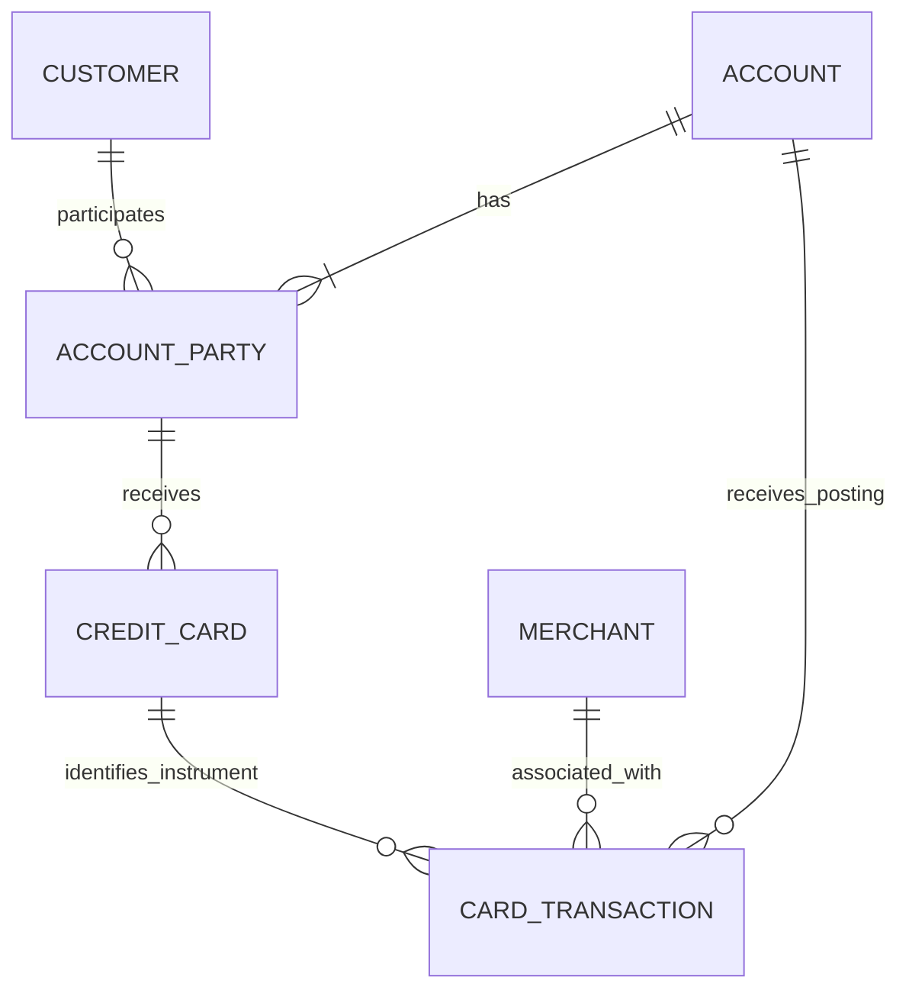

# Module 01A — Conceptual model

Status: first document draft, awaiting learner document review.  
Scope: one account, two cardholders, two workloads; business semantics only.

[business-rules.md](business-rules.md) owns the business policies and baseline fixture. [data-dictionary.md](data-dictionary.md) defines the proposed attributes. This document explains entities and relationships without choosing SQL implementation mechanisms.

## 1. Entity grains and identity

| Entity | Exactly one row represents | Business identity / candidate key |
|---|---|---|
| customer | One synthetic person recognized by the issuer, independent of accounts | customer_ref |
| account | One distinct CAD credit account, independent of cards | account_ref |
| account_party | One retained assignment of a customer to an account in a role | (account_ref, customer_ref, role) |
| credit_card | One issued instrument assigned to one participant on one account | card_ref |
| merchant | One source-recognized merchant acceptance identity | merchant_ref |
| card_transaction | One immutable purchase or refund financial posting | posting_ref |

References are unique in the single synthetic source and their entity scope. These are conceptual candidate keys; no database primary-key implementation has yet been selected. There are no additional candidate keys asserted without a uniqueness guarantee.

## 2. Relationship map

The account-to-card relationship is implied through the specific account participation. Each card also carries its account reference; these must agree. The diagram is not permission to match a card or posting to all account participants.

| Relationship | From the parent | From the child | Optionality / consistency |
|---|---|---|---|
| customer → account_party | Zero to many assignments | Exactly one customer | A customer can exist without participation |
| account → account_party | One to many retained assignments for an established account | Exactly one account | Open-account primary-role rule is additional to this cardinality |
| account_party → credit_card | Zero to many issued cards | Exactly one assigned participant | Account/customer/role must identify that exact assignment |
| account → credit_card | Zero to many cards | Exactly one account | Must equal the assigned participant's account |
| account → card_transaction | Zero to many postings | Exactly one account | Must equal the referenced card's account |
| credit_card → card_transaction | Zero to many postings | Exactly one issued instrument | A card need never be used |
| merchant → card_transaction | Zero to many postings | Exactly one merchant in this module | Merchant identity is not its display name |
| purchase posting → refund posting | Zero to many refunds | Exactly one original purchase for a refund | Purchases have no original-purchase link; account/currency must agree |

The parent can have no children without making the child's parent reference optional. For example, an unused card is valid; a posting without a card is outside this module's stated scope.

## 3. Why the participation relationship is an entity

The customer describes a person. The account describes a credit relationship. The participation describes that person's role in that relationship. The card describes an instrument issued to that participant.

Those facts change independently. A participant may hold multiple cards, retain their participation after a card replacement, or have no issued card. Storing participation only as an inference from card rows would confuse membership with instrument possession.

The learner selected one retained assignment per customer/account/role, with current status updated in place. This keeps the composite identity sufficient for this scope. It does not retain separate episodes or past statuses. Ending and restarting the same role reuses that assignment identity. A different role denotes a different assignment.

The role is part of this selected identity, so changing role in place would change the meaning of the row. Exact policies for incompatible simultaneous roles are not introduced by this checkpoint.

## 4. Identity across changes

| Change | Identity result |
|---|---|
| Alex changes name | C001 remains C001; update descriptive attributes |
| Merchant Alpha changes display name | M001 remains M001 if the source merchant identity is unchanged |
| K001 is blocked | Same instrument, changed status |
| K001 is replaced by K003 | New instrument row; retain K001; existing postings keep K001 |
| Another card is issued to Alex on A001 | New card reference, same existing participation |
| An assignment becomes inactive | Same triple, changed current status; preserve references |
| A refund occurs | New posting reference linked to the original purchase |
| P001 is delivered again | Same posting identity, not another purchase |

Do not recycle references after closure. Do not reassign an old card reference to a different account or person to model a replacement.

## 5. Three different questions about the same data

| Question | Meaning of the result | Relationship path |
|---|---|---|
| What is A001's net purchase activity? | Sum each posting on A001 once | posting → account |
| Which assigned cardholder is associated with each posting? | Attribution through the instrument's assigned participant | posting → card → specific participation → customer |
| Which participant is currently liable for A001? | Current account-role lookup | account → participation filtered to active primary role |

The third question does not identify which cardholder's instrument was used. It also does not establish who was liable at an arbitrary historical time, because status history is not retained here.

When all postings are matched to all account participants, one resulting row represents a posting/participant pair. A sum at that combined grain repeats amounts. Fix the relationship to suit the question; do not erase legitimate equal-valued postings merely because amounts repeat.

## 6. Financial versus authorization grain

An authorization and a posting retain separate identities and meanings. The former concerns a requested transaction decision; the latter records financial activity. Their relationship is not guaranteed one-to-one. Module 01A creates only posting entities.

The posting name is deliberately precise even though the entity is called card_transaction. The definition controls membership: unposted requests, authorization decisions and failed attempts are not additional posting rows.

## 7. Review prompts

Read the diagram and explain how a card can have one assigned participant while its account has several participants. Then locate the relationship that would multiply each posting if traversed without selecting the relevant role/person.

Confirm that current-status participation is sufficient for this exercise and that the document makes no promise to reconstruct past participation periods. This is a document review, not a requirement to reopen the already-correct amount exercise.
